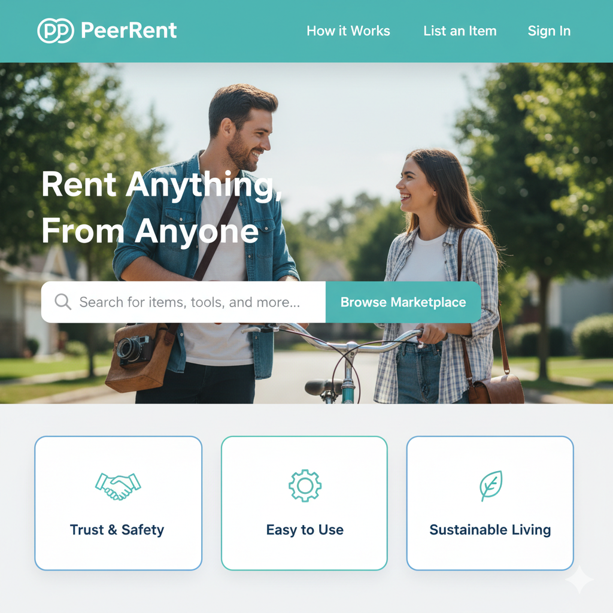
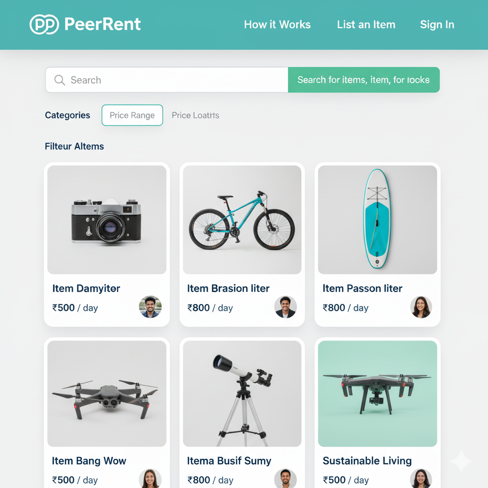
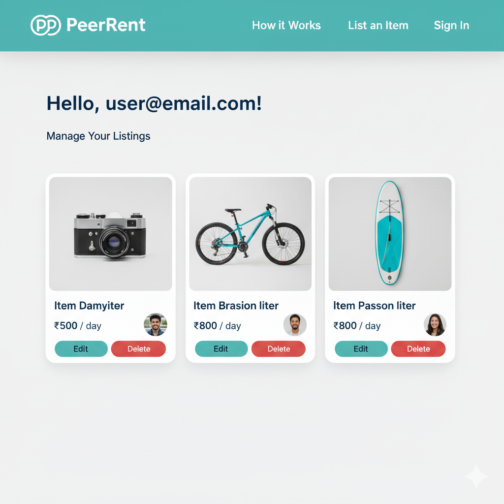
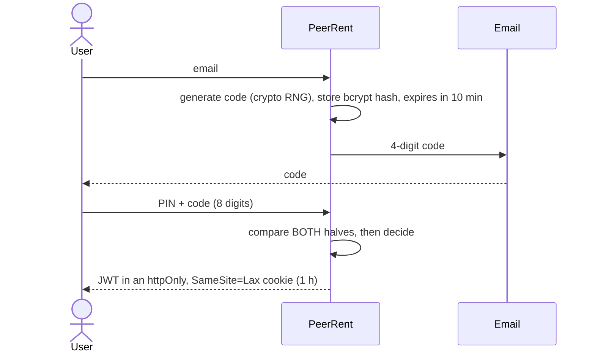

# PeerRent

[](https://github.com/Dead-Done/PeerRent/actions/workflows/ci.yml)
[](LICENSE)


A peer-to-peer rental marketplace: list things you own, rent things you need, and build
trust through reviews. Built with Node.js, Express 5, MongoDB and server-rendered EJS.

Its login system uses no passwords. Users sign in with a **4-digit PIN they remember
plus a 4-digit code sent to their email**, entered together as one 8-digit key.

Built by **[Dead-Done](https://github.com/Dead-Done)**.

| Home | Marketplace | My Listings |
|---|---|---|
|  |  |  |

## Features

- **PIN + email-code login.** Nothing reusable is stored except a bcrypt-hashed PIN, and the email code is single-use.
- **Listings.** Create, edit and delete items with up to 10 photos (JPEG, PNG, GIF or WebP, 5 MB each). Prices are in BDT.
- **Marketplace search** across item names and descriptions.
- **Rental workflow.** A request moves from pending to accepted or declined, and an accepted rental moves to completed. Only valid transitions are allowed, and only the owner can change status.
- **Reviews and ratings.** After a completed rental, the renter rates the owner (1–5 stars plus a comment). Profiles show the average rating.
- **Admin panel.** Platform stats, plus user, item and rental oversight and item moderation, behind a separate session-based login.
- **Dual interface.** Every endpoint serves both HTML forms (redirects and re-rendered pages with errors) and JSON API clients (Bearer token).

## How login works



The design avoids the usual weak spots of short numeric codes:

- **No partial feedback.** A wrong PIN, a wrong code, an expired code and an unknown email all return the same message, and both bcrypt comparisons always run. An attacker can't solve the two halves separately.
- **Attempt cap.** After 5 wrong tries the code is invalidated and the user has to request a new one.
- **Rate limiting** on register, code request, verify and admin login (20 requests per IP per 15 minutes, configurable).
- **No account enumeration.** Requesting a code for an unknown email looks exactly like requesting one for a real account.
- **Codes are never stored in plain text**, and they're generated with `crypto.randomInt`.

## Tech stack

| Layer | Choice |
|---|---|
| Runtime / framework | Node.js ≥ 20, Express 5 |
| Database | MongoDB with Mongoose 8 |
| Views | EJS (server-rendered) |
| Auth | bcryptjs, jsonwebtoken, express-session (admin) |
| Security | helmet, express-rate-limit, SameSite cookies |
| Uploads / email | Multer, Nodemailer (Mailtrap in development) |
| Tests / CI | Jest, Supertest, mongodb-memory-server, GitHub Actions |

## Getting started

**Prerequisites:** Node.js 20+, a MongoDB instance (local or Atlas), and SMTP credentials.
A free [Mailtrap](https://mailtrap.io) inbox works for development.

```bash
git clone https://github.com/Dead-Done/PeerRent.git
cd PeerRent
npm install
cp .env.example .env      # then fill in the values
npm run dev               # or: npm start
```

Open http://localhost:3000. The admin panel is at http://localhost:3000/admin.

### Environment variables

The server refuses to start if any required variable is missing.

| Variable | Required | Purpose |
|---|---|---|
| `MONGODB_URI` | yes | MongoDB connection string |
| `JWT_SECRET` | yes | Signs user login tokens |
| `SESSION_SECRET` | yes | Signs admin session cookies |
| `ADMIN_ID`, `ADMIN_PASSWORD` | yes | Admin panel credentials |
| `MAIL_HOST`, `MAIL_PORT`, `MAIL_USER`, `MAIL_PASS` | for login | SMTP used to send login codes |
| `PORT` | no | Defaults to 3000 |
| `NODE_ENV` | no | `production` turns on secure cookies and trusts the proxy |
| `AUTH_RATE_LIMIT` | no | Auth requests per IP per 15 minutes (default 20) |

To generate a secret:

```bash
node -e "console.log(require('crypto').randomBytes(32).toString('hex'))"
```

## Testing

```bash
npm test               # integration tests against an in-memory MongoDB
npm run test:coverage
```

The suite covers the login flow (including lockout, expiry and enumeration resistance),
item ownership rules, rental status transitions, review eligibility, admin sessions and
error handling. CI runs it on Node 20 and 22 for every push and pull request.

## API

Every route accepts form posts and JSON. API clients authenticate with
`Authorization: Bearer <token>`, using the token returned by `verify-otp`.

<details>
<summary><b>Endpoints</b></summary>

**Auth**
| Method | Path | Notes |
|---|---|---|
| POST | `/api/users/register` | `{ email, secretPin }` (4 digits) |
| POST | `/api/users/login/request-code` | `{ email }`. Emails a 4-digit code |
| POST | `/api/users/login/verify-otp` | `{ email, fullOtp }` (PIN + code). Returns `{ token }` |
| GET | `/api/users/logout` | Clears the cookie |

**Items**
| Method | Path | Auth |
|---|---|---|
| GET | `/api/items`, `/api/items/:id` | public |
| POST | `/api/items` | user (multipart, field `photos`) |
| PUT / DELETE | `/api/items/:id` | owner |

**Rentals**
| Method | Path | Auth |
|---|---|---|
| POST | `/rentals/:itemId` | user (not the owner) |
| POST | `/rentals/:rentalId/status` | owner. `{ status }`: pending → accepted or declined, accepted → completed |
| POST | `/rentals/:rentalId/review` | renter, completed rentals only, once |

**Admin** (session): `GET /admin`, `POST /admin/login`, `GET /admin/dashboard`,
`GET /admin/users`, `GET /admin/items`, `GET /admin/rentals`,
`POST /admin/items/:itemId/delete`, `POST /admin/logout`

</details>

## Project structure

```
app.js              Express app: middleware, routes, error handling (importable by tests)
server.js           Entry point: env validation, MongoDB connection, listen
config/             env validation, mailer
controllers/        Request handlers (users, items, rentals, admin)
middleware/         JWT auth, admin session guard, rate limiting
models/             Mongoose schemas: User, Item, RentalRequest, Review
routes/             API, rental, admin and page routes
utils/              Form/API detection, regex escaping, upload cleanup
views/              EJS pages and partials
tests/              Jest + Supertest integration tests
docs/               Admin guide, auth testing notes, demo script, original requirements
```

## Security notes

- Secrets come from the environment only. There are no defaults in code.
- Admin login uses a timing-safe comparison and issues a fresh session ID.
- Cookies are `httpOnly` and `SameSite=Lax`, and `Secure` in production. SameSite blocks
  cross-site form posts from carrying the cookie. Dedicated CSRF tokens are on the roadmap.
- Helmet sets the standard security headers. Its Content-Security-Policy is off for now,
  because the views still use inline scripts. Moving them out is on the roadmap.
- Search input is escaped before it goes into a MongoDB regex.

## Roadmap

- Rental dates, pricing totals, and availability that blocks overlapping bookings
- Categories, price filters and pagination in the marketplace
- Two-way reviews (owner reviews renter)
- Email notifications for rental requests and status changes
- Move inline scripts and styles to static assets, then enable CSP and CSRF tokens
- Docker Compose setup, cloud image storage and a hosted demo

## Documentation

- [Admin setup](docs/ADMIN_SETUP.md) · [Simple admin guide](docs/SIMPLE_ADMIN_GUIDE.md)
- [Hybrid OTP testing](docs/HYBRID_OTP_TESTING.md) · [Authentication testing](docs/AUTHENTICATION_TESTING.md)
- [Demo script](docs/DEMO_SCRIPT.md) · [Original requirements](docs/requirements.md)

## License

[ISC](LICENSE) © 2025 Dead-Done
